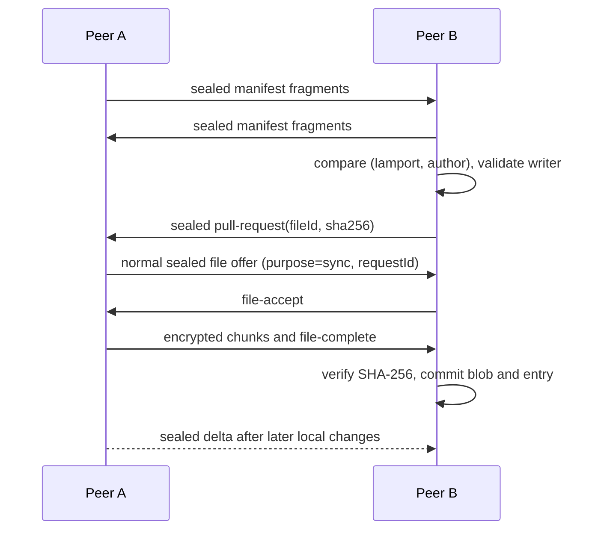

# ZeroCloud

ZeroCloud is a browser-based peer-to-peer collaboration project. Files and file metadata are encrypted in the browser before travelling directly over WebRTC DataChannels. PostgreSQL stores accounts and workspace metadata, including sealed workspace names and wrapped workspace keys; it never receives plaintext files, workspace names, workspace keys, invite secrets, or private identity keys.

## Requirements

- Node.js 20 or newer
- pnpm 10
- Docker Compose
- A modern browser with WebCrypto and WebRTC support

## Local setup

On a first setup, copy the example environment file and replace the local JWT secret with a fresh random value of at least 32 characters. If you already have a `.env`, merge the new entries instead of overwriting it.

```sh
cp .env.example .env
docker compose up -d
pnpm install
pnpm db:migrate
pnpm dev
```

Open <http://localhost:3000/register> to create an account. Account registration is tied to the identity key in that browser's IndexedDB. Sign in from that same browser profile, then create and open workspaces at <http://localhost:3000/workspaces>. The API and signalling server run on port `4000`.

The required environment values are `DATABASE_URL`, `ALLOWED_ORIGIN`, `WEB_ORIGIN`, and `JWT_SECRET`. `JWT_SECRET` must be at least 32 characters. Set `NEXT_PUBLIC_WEB_ORIGIN` to the browser-visible equivalent of `WEB_ORIGIN` for invite URLs. The browser uses `NEXT_PUBLIC_API_URL` (defaults to `http://localhost:4000/api`). `TEST_DATABASE_URL` must point to the separate `zerocloud_test` database.

The Postgres initialization script creates `zerocloud_test` when a new named volume is initialized. Existing volumes do not rerun initialization scripts; if needed, create the test DB once with:

```sh
docker compose exec postgres sh -c 'createdb -U "$POSTGRES_USER" zerocloud_test'
```

## Accounts and identity binding

Registration sends the account email, display name, password, identity public key, algorithm, and SHA-256 fingerprint. The server hashes passwords with Argon2id and independently recomputes the fingerprint. The private identity key remains in IndexedDB and is never sent to the server. A fingerprint can register only one account. The server does not prove private-key possession during registration; peers confirm key agreement through the Phase 4 handshake.

Login returns the registered fingerprint. The browser compares it to its local identity before saving the session. A mismatch blocks login with **This account is bound to a different device identity**. There is no identity rebinding, backup, password reset, or account recovery in this phase. Clearing site data or resetting the identity permanently loses access to that account's workspaces.

Sessions are HS256 JWTs with a 12-hour expiry. The browser keeps the token in memory and `sessionStorage` so a page reload preserves the session until the tab is closed or the token expires. JavaScript running through an XSS vulnerability can read a `sessionStorage` token; this is a deliberate trade-off for this phase. The server never logs passwords or tokens.

## Workspaces and key flow

Workspace IDs are generated in the browser. The browser creates a random AES-256-GCM workspace key, seals the workspace name, and wraps the raw workspace key for the creator's identity. The API receives only `name_sealed` and `wrapped_key`; the wrapped key is stored in `workspace_keys` for the owner's current key version. Workspace keys are unwrapped into memory when a workspace is opened and are not persisted in IndexedDB.

Workspace details and member directory data are returned only to members; a non-member receives 404. On creation, the client encrypts the workspace name, creates the random workspace key and self-wraps it for the owner before the API stores those ciphertexts. On invite, the owner creates a fresh 32-byte secret and invite UUID, derives an invite key with HKDF, and seals the workspace key. The link is `/join/<inviteId>#<base64url-secret>`; its secret fragment is removed from the address bar after the invite page reads it. The invitee decrypts the workspace key in their browser, wraps it for their own identity, and posts only that wrapped key. The server locks the invite row and atomically adds the member, stores their wrapped key, and marks the invite used. The secret and plaintext key never reach the server. Owners can create editor/viewer invites with 1-hour, 24-hour, or 7-day expiry, list pending invites, and revoke them.

Run migrations with `pnpm db:migrate`. Numbered SQL files under `apps/signal/migrations` are applied once and recorded in `schema_migrations`; the runner uses parameterized queries for all dynamic values.

## REST API

| Method   | Path                                    | Purpose                                                                          |
| -------- | --------------------------------------- | -------------------------------------------------------------------------------- |
| `POST`   | `/api/auth/register`                    | Create an account bound to the submitted browser identity                        |
| `POST`   | `/api/auth/login`                       | Verify credentials and return a 12-hour session token and registered fingerprint |
| `GET`    | `/api/me`                               | Return the authenticated account and identity                                    |
| `POST`   | `/api/workspaces`                       | Create a workspace, owner membership, and self-wrapped key in one transaction    |
| `GET`    | `/api/workspaces`                       | List the caller's workspaces with role and sealed names                          |
| `GET`    | `/api/workspaces/:id`                   | Return a member's wrapped key, current version, and member directory             |
| `POST`   | `/api/workspaces/:id/invites`           | Create a sealed single-use editor/viewer invite (owner only)                     |
| `GET`    | `/api/workspaces/:id/invites`           | List pending invites (owner only)                                                |
| `DELETE` | `/api/workspaces/:id/invites/:inviteId` | Revoke a pending invite (owner only)                                             |
| `GET`    | `/api/invites/:inviteId`                | Return authenticated invite metadata and sealed workspace key                    |
| `POST`   | `/api/invites/:inviteId/accept`         | Atomically accept invite and store the caller's wrapped key                      |
| `PATCH`  | `/api/workspaces/:id/members/:userId`   | Change a member to editor or viewer (owner only)                                 |
| `DELETE` | `/api/workspaces/:id/members/:userId`   | Remove a member and delete wrapped keys (owner only)                             |

Request bodies and path parameters are validated with Zod. Responses use `{ "error": { "code": "...", "message": "..." } }`. Authentication endpoints are rate limited to 10 requests per minute per IP. Helmet sets HTTP security headers, and CORS is restricted to `ALLOWED_ORIGIN`.

## Cryptographic design

| Primitive                         | Purpose                                                                                   |
| --------------------------------- | ----------------------------------------------------------------------------------------- |
| ECDH X25519, with P-256 fallback  | Persistent browser identity agreement                                                     |
| HKDF-SHA-256                      | Derive per-connection session keys from identity ECDH and both fresh nonces               |
| AES-256-GCM session key           | Seal file metadata and confirm the handshake                                              |
| AES-256-GCM fresh file key        | Encrypt each file chunk; chunk index and transfer context supply unique IV/AAD values     |
| SHA-256                           | Identity fingerprints and final plaintext file integrity check                            |
| ECDH + HKDF-SHA-256               | Derive a key-wrapping key from the wrapper and recipient identity keys                    |
| AES-256-GCM wrapped workspace key | Seal the 256-bit workspace key with workspace ID, version, and both fingerprints in AAD   |
| HKDF-SHA-256                      | Derive version-specific `ws-name` and `ws-sync` keys from each workspace key and version  |
| AES-256-GCM derived name key      | Seal the workspace name with `zerocloud/v1/ws-name`, workspace ID, and key version as AAD |
| AES-256-GCM derived sync key      | Prove current workspace-key possession and inner-seal sync data and sync-purpose file offers |
| HKDF-SHA-256 invite key           | Derive an invite-scoped sealing key from the URL-fragment secret and invite ID            |
| AES-256-GCM invite envelope       | Seal the workspace key for invite redemption, bound to workspace, invite, and key version |

Each DataChannel exchanges one hello containing an algorithm, public key, and fresh 32-byte random nonce. Both peers independently sort raw public keys and nonces bytewise, derive a symmetric HKDF salt, and exchange a direction-bound sealed ready message. Tabs sharing one browser profile can have the same identity and are marked **same identity as this device**.

Handshake state flow: workspace-authenticated → joined with peer directory → WebRTC offer/answer and ICE → DataChannel hello with nonce → compare hello fingerprint against the directory → derive the Phase 4 session key → exchange nonce/fingerprint-bound sealed `ready` messages → secure. A directory mismatch is marked identity mismatch and blocks chat/file handling for that peer. Failure to validate or confirm the handshake never reaches the secure state.

Workspace wrapping derives ECDH bits from the wrapper's private key and recipient's public key. Sorted, length-prefixed public keys feed the SHA-256 HKDF salt; the HKDF info is `zerocloud/v1/wrap`. The wrap envelope AAD binds the workspace ID, uint32 key version, wrapper fingerprint, and recipient fingerprint. Self-wrap is supported. A workspace key derives separate, non-extractable AES-GCM keys for name and sync use with HKDF-SHA-256, workspace UUID salt, and purpose/version-specific info. Names use AAD `zerocloud/v1/ws-name || rawWorkspaceUUID || uint32(keyVersion)`. Version-1 names written by the earlier raw-key scheme are read through a compatibility fallback and will be rewritten under the derived name key during the next rotation.

### Checkpoint A: workspace key rotation

The owner can rotate a workspace key or remove a member with a new key in one database transaction. Rotation replaces the sealed workspace name and inserts a wrapped new key for every current member, increments `current_key_version`, clears `needs_rotation`, and revokes pending invites. The member-removal route rejects requests without the full rotation payload; it removes that member's wraps and membership in the same transaction. Old key versions remain available to current members so they can still read earlier workspace content. The authenticated API exposes each member's wraps only to that member and the workspace's current version metadata only to workspace members.

Members can leave through `POST /workspaces/:id/leave`. Their membership and wraps are deleted, `needs_rotation` is set, and the owner receives a live rotation-needed event. The owner must rotate before new content is protected from the departed member's old key. Pending invites are accepted only while their key version remains current. The browser keeps imported workspace keys in a memory-only keyring; IndexedDB stores only TOFU pins of member public keys. A pin mismatch blocks rotation until an owner explicitly reviews and updates the pin after checking the fingerprint out of band. Rotation confirmation presents recipient fingerprints and asks the owner to confirm unverified recipients.

## Roles and authenticated signaling

Roles are `owner` (workspace creator), `editor` (send and receive), and `viewer` (receive only). Only owners can invite, change roles, or remove members. An authenticated WebSocket must send its JWT within five seconds and can join only a workspace where its user is a member. The workspace peer directory supplies identity fingerprints and roles; the joining peer creates offers to peers already listed, while existing peers answer. Hello fingerprints must match the directory before the Phase 4 encrypted ready handshake can mark a peer secure. Same-profile tabs may share an identity and are labelled accordingly. Members, roles, presence, kicks, and peer departures update over the workspace room in real time.

The sender UI disables file sending for viewers. Receivers automatically reject offers from a viewer or a peer with unknown role using `no write permission`. This is cooperative protection among honest clients; a modified client can bypass its own UI checks. The directory comes from the server, so out-of-band fingerprint verification remains important against a malicious server. The server sees the social graph: who belongs to which workspace and when members are online.

After removal or leave, old keys and files already received cannot be erased. Rotating the key protects new content from a removed member, but the server cannot make a departed device forget prior plaintext or keys.

Chat remains protected by WebRTC DTLS and the authenticated transport session only; it is not encrypted under the workspace key.

## Workspace peer and file-transfer testing

Open a workspace in two authenticated browser profiles, create an invite from the owner profile, and open the link in the second profile. The invite secret appears only after `#`, and the page strips it from the address bar after reading it. Join the workspace from each tab and test chat and direct file transfer. The invitation is single use and expires on its selected schedule; pending invites may be revoked. Configure STUN/TURN with `NEXT_PUBLIC_STUN_URLS`, `NEXT_PUBLIC_TURN_URL`, `NEXT_PUBLIC_TURN_USERNAME`, and `NEXT_PUBLIC_TURN_CREDENTIAL`. Comma-separated TURN URLs share one username and credential. These browser-visible credentials should be intended for client use, such as short-lived TURN credentials.

`NEXT_PUBLIC_FORCE_P256=true` forces a P-256 identity. `NEXT_PUBLIC_DEBUG_WIRE=true` adds ciphertext prefixes and byte counts to the debug panel. `NEXT_PUBLIC_DEBUG_TAMPER=true` flips a bit in the third file chunk during development to exercise integrity failure.

## Workspace file library and peer sync (Phase 6)

Checkpoint A adds the **Files** workspace tab and stores each browser's local file library in IndexedDB. Entries are keyed by `[workspaceId, fileId]`; blobs are stored separately with their SHA-256 digest, and a per-workspace metadata record keeps the Lamport high-water mark. Uploads hash the file with browser WebCrypto before saving. Blob and entry writes share one transaction, so an aborted or quota-failed replacement leaves the previous committed file intact. Storage usage is estimated with the browser Storage API, with a warning at 80%.

Files are plaintext in local IndexedDB during this phase. This is a documented limitation; Phase 6 does not add encryption at rest. The library stores a separate local copy in each browser profile.

Writers (owners and editors) may upload, replace, keep both same-named files, and delete. Viewers can only download locally present files. Delete keeps a tombstone and removes the local blob. Tombstones count toward the 500-entry workspace limit and are not garbage-collected in this phase. File identity is the UUID `fileId`; a replace creates a newer entry for that ID, while Keep both creates another ID. If multiple live entries share a name, the UI adds their author display name for clarity.

Entry order is last-writer-wins by `(lamport, author)` in ascending lexicographic order; the greater tuple wins. Lamport values are workspace-local and a new local change uses one greater than the highest value seen. `modifiedAt` is display metadata and does not determine the winner. Concurrent changes to the same file ID can therefore silently overwrite the losing entry.

Each member keeps its own IndexedDB copy. On a secure, directory-authorized DataChannel, peers exchange manifests, compare entry versions, and request missing blobs directly from a peer that advertised the exact version. Deltas announce writer changes. The server is unchanged and receives no names, sizes, hashes, manifest entries, or file bytes.

Sync message payloads (inside the encrypted envelope):

| Message        | Payload                                                                 | Purpose                                                 |
| -------------- | ----------------------------------------------------------------------- | ------------------------------------------------------- |
| `manifest`     | `syncId`, fragment index/count, up to 12,000 plaintext bytes of entries | Exchange the full entry set on a secure peer connection |
| `delta`        | Up to 20 entries                                                        | Broadcast local writer changes to secure peers          |
| `pull-request` | `requestId`, `fileId`, expected SHA-256                                 | Request a particular local blob from a peer             |
| `pull-denied`  | `requestId`, `not-found`, `hash-mismatch`, or `forbidden`               | Explain why the requested blob cannot be sent           |

The DataChannel wire form is `{ type: "sync", header, sealed }`. The strict, cleartext header contains exactly `{ v: 1, messageType, workspaceId, syncId, partIndex, totalParts, seq, keyVersion }`. It contains no file names, hashes, sizes, file IDs, or entries. Header fields are validated before decryption; messages for another workspace are silently dropped. The receiver builds AES-GCM AAD from the received header and the sender/receiver fingerprints bound by the Phase 4 key-confirmed peer connection, in this order: `zerocloud/v1/sync || messageType || workspaceId || syncId || partIndex || totalParts || seq || keyVersion || senderFingerprint || receiverFingerprint`. Changing any authenticated value causes decryption to fail.

`seq` is a per-sender, per-connection counter beginning at 1. A message group increments it once; all fragments of one manifest share that sequence. Receivers reject any sequence at or below the highest accepted sequence, except distinct fragment indexes in that same manifest group. A new peer connection has a fresh Phase 4 session key and reset counters. Manifest assembly is keyed by peer connection and sync ID, bounded to 1 MB and 128 fragments, expires incomplete assemblies after 30 seconds, and discards an assembly if a part fails authentication. Wire messages including the header are capped at 16 KiB. The encrypted channel also uses WebRTC DTLS.



The peer that advertised an entry is a candidate source. A requester will only auto-accept a `purpose: "sync"` transfer when its request ID, peer, expected size, and hash match an outstanding pull. Pulls queue at a maximum of two per peer and four total, retry up to three times with exponential backoff, and try another peer advertising the same hash when possible. The transfer itself remains the existing encrypted Phase 3/4 file-transfer path. Quick send remains a separate ad-hoc transfer. In development, `NEXT_PUBLIC_DEBUG_FORGE_VIEWER=true` adds a viewer-only control for sending a deliberately forged delta; authorized peers reject its viewer authorship.

Known Phase 6 limitations:

- Last-writer-wins may silently discard a concurrent edit; there is no conflict UI or file history.
- Entry authorship is not signed. A malicious workspace writer could forge another writer's fingerprint in metadata.
- Local IndexedDB blobs are plaintext at rest.
- Sync runs only while browser tabs are open; there is no background sync.
- Members retain files and keys they copied before removal; rotation protects only new content.
- The cleartext sync header (message type, workspace ID, fragment count/index and sequence) is visible only to the peer browser; sync messages do not pass through the signalling server. DataChannels are additionally protected by DTLS.
- The signalling server learns which members are online in each workspace, but never receives filenames, file sizes, hashes, manifests, or file contents.

To verify sync locally, open the same workspace in two authenticated browser profiles, join from both, wait until each peer shows `in sync`, then upload a file in **Files**. The other profile should show the file progressing from queued/pulling to synced; download it there and compare its digest with `sha256sum`. Close one profile, make a change in the other, then reopen and rejoin the first profile to verify manifest catch-up. The development-only random operations control runs for at most 60 seconds and the state hash appears in the peer debug panel.

## Phase 7 Checkpoint B: workspace-key-gated data plane

Each secure peer connection must prove possession of the current workspace sync key in both directions before sync, file transfer, or chat is enabled. A `ws-proof` message is inner-sealed with the version-specific workspace sync key and then outer-sealed with the Phase 4 session key. Its plaintext is a SHA-256 digest over the protocol label, independently sorted connection nonces, and ordered sender/receiver fingerprints. The sender nonce is also included as a direction marker so reflecting a proof fails even when two tabs share the same browser identity and fingerprint.

Ordinary sync payloads use two encryption layers: the workspace sync key seals the payload with AAD `zerocloud/v1/ws-inner || workspaceId || uint32(keyVersion) || messageType || syncId || partIndex || totalParts`; the Phase 4 session key seals that ciphertext with the outer sync header and peer-fingerprint AAD described above. Sync-purpose file offers are similarly workspace-key sealed and bound to workspace, key version, transfer ID, and sender/receiver fingerprints before being sent over the session-protected DataChannel. Quick Send stays outside workspace-key encryption and is disabled for peers that have not proved the current workspace key.

The `stale-key` control carries an empty plaintext protected by the outer session seal. Its key version and sequence are authenticated and it uses the same replay counter as other sync messages. When a peer reports a newer version, the browser waits up to 30 seconds for the workspace key and attempts one key refresh with a 10-second timeout; successful refresh restarts proof at the new version. Rotation immediately invalidates existing proof state. A peer removed from the workspace is marked no-access locally and its active transfers are stopped.

The protocol retains the 500-entry manifest and existing name/field limits. Fragment plaintext is at most 11 KiB, fragments are capped at 128, complete manifests are capped at 1 MiB, and each wire envelope is capped at 16 KiB. Incomplete assemblies expire after 30 seconds.

Known Checkpoint B limitations:

- The sync header (including message type, workspace ID, key version, sequence, and fragment sizes/counts) is visible to the peer browser, never the signalling server. DataChannels are additionally protected by DTLS.
- Chat is protected by DTLS and the transport session only, not by the workspace key. Clients disable chat to and from peers not verified at the current workspace key version.
- Workspace-key possession proves access to the current key, not that a peer is honest or that previously copied content has been erased. Removed members may collude with a remaining member who shares the new key.
- Key fetch and verification require an open, authenticated browser session. A missing key, denied key fetch, or failed proof leaves that peer without workspace data-plane access.

To test Checkpoint B, join the same workspace from two authenticated browser profiles and wait for both rows to show workspace verified. Confirm sync and chat become available only after that state. Rotate the workspace key and verify both remaining profiles re-prove at the new version. Remove a member with rotation and verify its peer row becomes no-access and transfers stop. `NEXT_PUBLIC_DEBUG_IGNORE_KICK=true` and `NEXT_PUBLIC_DEBUG_BLOCK_KEYFETCH=true` are development-only switches for exercising stale-key timeout behavior.

## Tests and known limitations

Run `pnpm test`, `pnpm typecheck`, and `pnpm lint`. API tests use `TEST_DATABASE_URL` and truncate tables between tests; never point it at a development or production database. Workspace crypto tests use Node WebCrypto and cover X25519/P-256 wrapping, self-wrap, wrong recipients, AAD tampering, sealed names, and invite-key sealing with correct and incorrect secrets.

- No key recovery, key backup, password reset, email verification, or multi-device identity.
- Chat is protected by DTLS and the transport session only, not by the workspace key.
- Registration binds the submitted public key but does not prove private-key possession.
- JWTs in `sessionStorage` are exposed to JavaScript executing through XSS.
- Data-plane role enforcement is cooperative among honest clients.
- The server sees the social graph: account/workspace membership and when peers are online.
- Chat remains plaintext; Phase 4 encrypts file content and file metadata.

## Health and quality commands

```sh
curl http://localhost:4000/health
pnpm db:migrate
pnpm test
pnpm typecheck
pnpm lint
pnpm build
```
