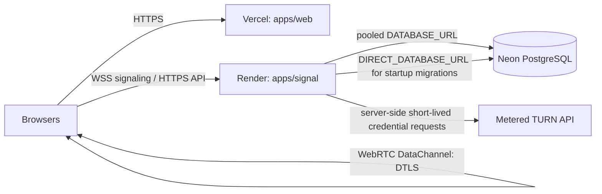

# Production deployment

This guide deploys the web app to Vercel, the Express/WebSocket signal service to Render, and PostgreSQL to Neon. Vercel serves the browser UI, Render serves HTTPS and WSS plus the authenticated API, and Neon stores accounts and workspace metadata. Files remain in browser storage and are transferred peer to peer. `pg_dump` and `pg_restore` from PostgreSQL client tools must be available on the machine running the backup or restore command.



Neon is selected for managed PostgreSQL and provides separate pooled and direct connection strings. Use the pooled URL for the long-running app pool. Use the direct URL only for migrations, backup/restore, and other session-level operations. The migration runner opens one dedicated connection, obtains a session advisory lock, applies pending migrations, unlocks, and closes the connection before the HTTP server listens. Render's start command runs migrations during each instance startup; migrations are idempotent and serialized across instances.

## Environment variables

Set these under Render's environment settings. Values marked **secret** must be stored as encrypted secrets and must never be prefixed `NEXT_PUBLIC_`.

| Render variable | Secret? | Value / purpose |
| --- | --- | --- |
| `NODE_ENV` | No | `production` |
| `PORT` | No | `10000` (Render's web service port) |
| `DATABASE_URL` | **Yes** | Neon pooled connection string (`-pooler` host); application pool |
| `DIRECT_DATABASE_URL` | **Yes** | Neon direct connection string; startup migrations, backup, restore |
| `DATABASE_SSL` | No | `true`; TLS with certificate verification |
| `ALLOWED_ORIGIN` | No | Exact Vercel production origin, e.g. `https://zerocloud.example.com` |
| `WEB_ORIGIN` | No | Same public Vercel origin, used in invite links |
| `JWT_SECRET` | **Yes** | Random value of at least 32 characters; not the example placeholder |
| `DB_POOL_MAX` | No | Optional; default `10` |
| `DB_IDLE_TIMEOUT_MS` | No | Optional; default `30000` |
| `DB_CONNECTION_TIMEOUT_MS` | No | Optional; default `15000` |
| `ICE_MODE` | No | `provider` to use Metered short-lived credentials; `static` for fallback |
| `TURN_APP_NAME` | No | Metered app subdomain/name; required in provider mode |
| `TURN_PROVIDER_SECRET` | **Yes** | Metered API secret; required in provider mode |
| `TURN_CREDENTIAL_TTL_SECONDS` | No | Optional; defaults to `3600`, allowed `300`–`86400` |
| `STUN_URLS` | No | Comma-separated STUN URLs, e.g. `stun:stun.l.google.com:19302` |
| `ICE_STATIC_URLS` | No | Comma-separated TURN URLs for static fallback |
| `ICE_STATIC_USERNAME` | **Yes** | Static TURN username; only required in static mode |
| `ICE_STATIC_CREDENTIAL` | **Yes** | Static TURN credential; only required in static mode |

Set these in Vercel project settings. Select monorepo root directory `apps/web`, enable inclusion of source files outside the root directory, and use pnpm 10. Vercel must be able to install the root workspace and build `packages/shared`.

Use install command `cd ../.. && pnpm install --frozen-lockfile` and build command `cd ../.. && pnpm --filter @zerocloud/shared build && pnpm --filter @zerocloud/web build`. The web package build checks the production WSS URL before invoking Next.js.

| Vercel variable | Secret? | Value / purpose |
| --- | --- | --- |
| `NEXT_PUBLIC_API_URL` | No | `https://<render-service>.onrender.com/api` |
| `NEXT_PUBLIC_SIGNAL_URL` | No | `wss://<render-service>.onrender.com/ws`; production build rejects any non-`wss:` URL |
| `NEXT_PUBLIC_WEB_ORIGIN` | No | Public Vercel origin used to form invite links |
| `NEXT_PUBLIC_ICE_URLS` | No | Public TURN/STUN host list for CSP only; never add usernames or credentials |
| `NEXT_PUBLIC_FORCE_RELAY` | No | Optional development/debug flag, normally `false` |
| `NEXT_PUBLIC_FORCE_P256` | No | Optional compatibility/debug flag, normally `false` |

`NEXT_PUBLIC_*` values are shipped to browsers. Never put database URLs, JWT secrets, Metered secrets, TURN usernames, or TURN credentials in them. The browser requests short-lived TURN credentials from the authenticated signal API. Remove legacy `NEXT_PUBLIC_TURN_URL`, `NEXT_PUBLIC_TURN_USERNAME`, and `NEXT_PUBLIC_TURN_CREDENTIAL` settings from Vercel and local env files.

## Ordered deploy checklist

1. Create a GitHub repository and push the project. Enable Actions; confirm the `CI` workflow passes on the deployment branch.
2. Create a Neon project and database. Copy both the pooled URL (for `DATABASE_URL`) and direct URL (for `DIRECT_DATABASE_URL`) into a secure password manager.
3. Create a Metered account/app and obtain the server API secret. Provider credentials are minted on demand, cached server-side, and refreshed before expiry. Metered notes that newly issued credentials may take up to two minutes to propagate; wait before concluding TURN is misconfigured.
4. Create a Render Blueprint from the repository and review `render.yaml`. Enter the secret values as secret environment variables and set the web origin values after Vercel deployment. Render starts the service with migrations before it begins listening; `/health` is its health check.
5. Create a Vercel project from the same repository with root directory `apps/web`. Enable workspace files outside the root directory. Set the public API, WSS, web-origin, STUN, and ICE-host variables above, then deploy.
6. Copy the final Vercel origin into Render's `ALLOWED_ORIGIN` and `WEB_ORIGIN`, save, and redeploy Render. Check Render `/health`; `db` must be `up` and status `ok`.
7. Open `https://<web-origin>/preflight` on a laptop and a phone. Sign in to each profile, check secure context, signaling, database status, ICE candidate types, and build IDs. Then run the two-account invite, secure handshake, and file-sync demo over WiFi and mobile data.
8. If you use an external uptime monitor, configure it to request `https://<render-service>.onrender.com/health` every five minutes. Monitoring reduces cold starts but consumes instance time; check the host's current free-tier instance-hour limits before enabling an uptime monitor. See [Render pricing](https://render.com/pricing) for current terms; do not assume a fixed free allowance.
9. Configure DNS only if using a custom domain: add the DNS records shown in Vercel for the web domain, and use the Render-provided hostname for API/WSS unless you also configure a custom Render domain. HTTPS certificates are provisioned by the hosting providers.

## ICE provider fallback

The signal service first uses Metered's credentials API: it creates a short-lived credential, fetches the corresponding ICE server URLs, and returns the credential bundle only to an authenticated user. The provider secret never leaves Render. The API is rate limited per user and the browser refreshes the bundle before it expires.

### If the API is not available on my plan

Set `ICE_MODE=static` in Render and set `ICE_STATIC_URLS`, `ICE_STATIC_USERNAME`, and `ICE_STATIC_CREDENTIAL` to the provider's static TURN values. Keep the username and credential as Render secrets. Redeploy and check `/preflight` for a `relay` candidate. Static credentials are longer-lived and less desirable operationally, so switch back to `ICE_MODE=provider` when the provider API is available. Both modes are exercised by unit tests with a mocked provider; those tests do not validate your live account plan or credentials.

## Migrations and operations

Migrations are forward-only. Add a new numbered SQL migration; do not edit a migration already applied to production. Back up before deploying a schema migration. If a release fails, redeploy the previous application commit. If the new schema is backward-compatible, the old app can use it; destructive schema changes require a later migration after the rollback window. Never manually delete migration records to force a rerun.

Migration `003_invite_list_order_index.sql` adds `invites_pending_by_workspace_created` on `(workspace_id, created_at DESC)` with the pending-invite predicate. It serves the owner pending-invite query that filters by workspace and orders newest first. Existing indexes continue to serve these query paths: unique `users(email)` and `users(fingerprint)` support login and identity-conflict lookups; `workspace_members` primary key `(workspace_id, user_id)` supports membership checks and workspace member directories; `workspace_members_by_user(user_id, workspace_id)` supports the caller's workspace list; `workspaces_by_owner(owner_id, created_at DESC)` supports owner workspace lookups; `workspace_keys` primary key `(workspace_id, user_id, key_version)` serves per-member key retrieval, and `workspace_keys_by_user(user_id, workspace_id, key_version)` supports reverse member-key lookup; `invites_pending_by_workspace(workspace_id, expires_at)` supports pending/expiry filtering; `invites_by_creator(created_by, workspace_id)` supports creator scoped invite queries. UUID primary keys serve direct workspace and invite ID lookups.

The app opens a dedicated direct connection for startup migrations and uses `DATABASE_URL` for normal queries. Startup waits for the database for up to about 15 seconds with backoff. Health probes return `db: "waking"` with HTTP 200 while a slow database is within the wake window and `db: "down"` with HTTP 503 after it remains unavailable. The web UI displays a waking message when health or WebSocket connection takes longer than three seconds and retries automatically.

Create a custom-format dump with `pnpm db:backup`; it is saved under `backups/` (gitignored). Restore requires the exact typed confirmation `RESTORE`:

```sh
pnpm db:backup
pnpm db:restore -- backups/zerocloud-<timestamp>.dump
```

For a recovery drill, restore into a scratch database URL by temporarily setting `DIRECT_DATABASE_URL` to that scratch database, then check the app's migrations and representative account/workspace reads before treating the dump as usable. Keep backup files and database credentials out of git and public storage.

## CSP and security behavior

The Next.js proxy generates a fresh nonce per request. CSP `connect-src` is constructed from the configured API origin, signaling origin (both HTTPS and WSS), and public ICE host list. Keep `NEXT_PUBLIC_ICE_URLS` aligned with TURN/STUN hosts the deployed browser may contact. The nonce-based policy avoids `unsafe-inline` for scripts. Development alone permits `unsafe-eval` for the dev runtime. Nonces require dynamically rendered pages; this is acceptable for this app. Styles use self and nonce sources; if a component library introduces inline styles, verify the browser console before making a narrowly scoped change.

The API sends `Cache-Control: no-store`. HTTP errors return generic messages and include a request ID for server-side log correlation. Structured server logs redact authorization, password, token, wrapped-key, sealed-payload, and secret fields. WebSocket payloads are capped at 256 KiB; per-IP and per-user socket limits are enforced. The signal server checks the browser origin against `ALLOWED_ORIGIN`.

## CI

The required quality job uses PostgreSQL 16 and runs frozen pnpm installation, typecheck, lint, tests, build, and the built-client secret scan. A separate audit job reports high/critical production advisories without blocking CI. The single Playwright smoke test runs in its own non-blocking job because headless WebRTC can be flaky; it registers two isolated browser contexts, creates/invites/joins a workspace, waits for a secure peer, and transfers a small file. If headless WebRTC proves flaky, use `pnpm e2e:smoke` locally and keep the documented CI job non-blocking; do not expand the browser suite.

No gitleaks-style action is configured. Before pushing, inspect staged files and run a secret scan locally; never stage `.env`, database dumps, or provider credential files.

## Troubleshooting

| Symptom | Check |
| --- | --- |
| WebSocket fails behind proxy | Confirm the browser URL is `wss://`, Render routes `/ws`, the Vercel origin exactly matches `ALLOWED_ORIGIN`, and the service heartbeat is visible in logs. |
| Render deploy dropped my WebSocket | Render deployments replace running instances and close existing WebSockets. The browser should reconnect; rejoin the workspace if its page does not recover. See [Render WebSockets](https://render.com/docs/websocket). |
| CORS errors | Set `ALLOWED_ORIGIN` to the exact scheme and host of the deployed Vercel origin, without a trailing path; redeploy the signal service. |
| CSP violations | Inspect the console directive and add only the exact actual origin/ICE host through the corresponding environment variable. Do not add broad wildcards. |
| TURN relay not used | Confirm `/api/ice-servers` succeeds, check `relay` in `/preflight`, verify Metered credentials and host allowlisting, and allow up to two minutes after credential creation for provider propagation. A direct `srflx` candidate can work without TURN. |
| Neon first request slow | The first query after idle can wake the database. `/health` should temporarily return `db: "waking"` (HTTP 200); allow retries for about 15 seconds and check Neon status/connection limits if it becomes `down`. |
| Database remains down | Verify pooled and direct URLs, SSL, Neon availability, and Render secrets. Check migration startup logs using the request-free generic error context; never paste credentials into an issue. |
| Invite says the secret is missing | Use the complete original invite URL including its `#` fragment. The fragment is removed immediately after the page reads it. |
